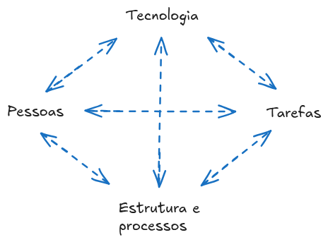
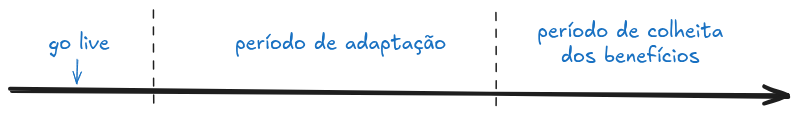

> Por *Rafael Monteiro*, rafael.monteiro@kukaisolutions.com
> **novembro de 2026**

> [!Introdução]
> Existe um paradoxo na adoção de tecnologia por corporações. Basta perguntar a algum gestor ou gerente se este gostaria de melhorar as métricas de atendimento ao consumidor na sua empresa com o uso de IA; com certeza a resposta será positiva. Agora pergunte quantas dessas pessoas gostam de ser atendidas por robôs quando têm um problema com um celular, ou internet em casa? Em geral, poucos gostam: a maioria prefere conversar com um humano. 
> 

 
Muito se tem discutido sobre a adoção de tecnologia em ambientes de trabalho. Há um constante burburinho envolvendo inteligência artificial (IA) e como ela há de revolucionar a forma como trabalhamos. Uma frase recorrente ouvida nos mais diferentes círculos (mídia, gestão, reuniões de C-level etc.) é que se você não está adotando alguma nova tecnologia ou colocando algum agente de IA para fazer alguma coisa na sua empresa, então você já está atrasado.

Na verdade, devemos contextualizar um pouco melhor essa opinião, pois ela é generalista; e, como toda declaração do tipo, incompleta. O que podemos dizer, em especial para áreas onde a interação humana prevalece como núcleo (como **Terapia Ocupacional**, **Psicologia**, dentre outras), é o seguinte:

 1. *Provavelmente seu negócio vai continuar funcionando sem a adoção de algumas dessas tecnologias.*
 2. *É até possível que a introdução de algumas delas leve à deterioração da qualidade do serviço que você oferece.* 

Curiosamente, e até em contraste com estes dois pontos, é possível também que alguma ferramenta de tecnologia seja aquilo de que você precisa para deixar de ter tantos problemas na sua empresa. Isso porque é comum os problemas de pequenos negócios se darem por motivos gerenciais ou operacionais, de certa forma alheios às capacidades do profissional em questão.

Neste texto seguiremos de perto *Hertzum (2022)*. Falaremos sobre a adoção de tecnologia em empresas, adaptando a discussão que ele faz para focarmos em um tipo de profissional que atua em áreas onde a interação **humano-humano** é a alma do negócio.

> [!NOTA]
> Em diversos momentos serei intencionalmente impreciso: usarei software e ferramenta como sinônimos, apesar de este último termo ser mais abrangente. Adeque a leitura ao contexto que fizer mais sentido para você.

## 1. Um diagrama de impacto em empresas

 Ao modelarmos a estrutura funcional de uma empresa podemos dizer que **impacto** é o efeito de qualquer ação em uma de suas áreas que se propague para outra(s), como se vê na figura 1.

<figure>
    
    <figcaption> <b>Figura 1.</b> Fluxo de impacto em uma organização. "Estruturas e processos" denota normas, trabalho de time, divisão de trabalho e hierarquias estruturais que ditam como o trabalho flui numa empresa. Este diagrama foi retirado de Hertzum (2022), figura 2.1.</figcaption>
</figure>

O diagrama nos ajuda a entender inúmeros exemplos:

1. *"Um colaborador saiu da empresa; contratei outra pessoa, que faz exatamente a mesma coisa"*. Esse é um exemplo em que não há impacto algum, pois o trabalho deste novo colaborador não alterou em nada as tarefas que são realizadas, nem implicou na adoção de alguma nova tecnologia, muito menos alterou a forma como o trabalho se dá no grupo. 
2. *"Contratei uma nova gestora, que alterou toda a estrutura do nosso time visando atender mudanças no perfil do cliente"*: este é um exemplo de impacto claro, onde uma pessoa está alterando uma estrutura de hierarquia e fluxo de trabalho.
3. *"Adotamos um software novo que acelera nosso trabalho e diminui o tempo entre requisição e entrega"*: este é um exemplo clássico em que a adoção de tecnologia impacta a forma como processos são realizados. Se houver remoção de tarefas por conta da adoção deste software, há também um impacto em tarefas. 
4. *"Troquei o software da empresa A por um igual e mais barato da empresa B"*: não haverá um impacto direto nas operações da empresa, apesar de a mudança abrir espaço para impactos secundários (mais dinheiro em caixa pode significar mais verba para contratação de outras pessoas, por exemplo).

  Quando pensamos no contexto de uma profissão cujo enfoque é interação **humano-humano**, as possibilidades de adoção de tecnologia em geral se restringem à alteração de processos (caso 3 acima) e, raras vezes, à alteração de tarefas. Assim, *quando você for avaliar a adoção de uma nova tecnologia, leve em conta onde almeja alterações e melhorias nas suas operações.*

## 2. A jornada de implantação de uma nova tecnologia

Diferenciemos algo importante logo de início: *contratar uma tecnologia não é o mesmo que adotá-la*;[^1] há uma distância enorme que separa essas duas coisas. 

<figure>
    
    <figcaption> <b>Figura 2.</b> Linha do tempo de adoção de tecnologia. Em geral, a maioria dos fracassos se concentra no período anterior à coleta de benefícios e se dá por inúmeros fatores, muitas vezes não relacionados às ferramentas em teste. Chama-se de "go live" o momento de disponibilização de uma tecnologia para uso por colaboradores. Esta imagem foi inspirada pelos capítulos 1 e 2 de Hertzum (2022). </figcaption>
</figure>

A integração de um software ou ferramenta aos processos da empresa pode demorar, ou mesmo nunca acontecer. Este período de adaptação[^2] é também um período de testes, onde se investiga prós e contras de sua adoção.[^3] 

### 2.1. O período de adaptação e o risco de fracasso na adoção

O período de adaptação ao uso de uma ferramenta é um dos mais difíceis. Nele, **conflitos e tensões** *tendem a emergir. No entanto, lembre-se: isso é esperado, dado que ambos são matéria-prima de toda e qualquer mudança.* É nessa fase em geral que uma adoção de ferramenta tende a fracassar, pois os riscos são inúmeros:
* Rejeição e/ou recusa[^4];
* Uso descontinuado;
* Adoção parcial.

A meu ver, os dois últimos são os piores casos, pois podem apontar que o software é desde o princípio incapaz ou insuficiente em atender as demandas da empresa. Os mesmos resultados também podem indicar inconveniência, dificuldade de uso, ou mesmo falta de treinamento adequado para seu uso pleno.

 O caminho que culmina em qualquer um desses resultados passa por uma complexa avaliação de custo-benefício feita pelos usuários finais. Em linhas gerais, podemos dividir custo-benefício em fatores que promovem a adoção de uma tecnologia, ou servem de obstrução a ela. 

| Fatores promotores     | Fatores de obstrução                                            |
| ---------------------- | --------------------------------------------------------------- |
| Rapidez                | Baixa compatibilidade com a tarefa                              |
| Confiabilidade         | Falta de suporte (como TI não acessível ou falta de manual)     |
| Facilidade de uso      | Falta de urgência                                               |
| Precisão da ferramenta | Fadiga de mudança                                               |
| Flexibilidade          | Falta de participação ou engajamento do time de usuários finais |

Há dois aspectos que vejo frequentemente e que aparecem na tabela acima:
* *Falta de urgência*: não é incomum ouvir de empresas que a adoção de tecnologia ou de uma nova ferramenta não é prioridade no momento. Em geral, são empresas que sofrem com alguns ou diversos dos seguintes problemas operacionais e estruturais:
	* **Falta de transparência nos gastos**;
	* **Falta de transparência em ganhos** (ex: *"não sei quanto ganhei neste mês"*);
	* **Falta de organização interna** (ex: *"não sei em que pasta salvei o prontuário do paciente"*);
	* **Falta de sistematização de processos** (ex: *"a colaboradora saiu em férias e esqueceu de fazer o relatório de atendimento, assim não consegui enviar a tempo para o convênio"*, ou *"a colaboradora precisa me enviar a imagem que ficou no celular dela, mas ela não atende o celular agora"*);
	* **Falta de flexibilidade** (ex: *"vou viajar, mas terei que levar o notebook e meus cadernos de anotação para atender meus pacientes"*);
	* **Falta de protocolos de segurança** (ex: *"deixo todas as anotações de consulta neste caderno que perdi na semana passada"*).
	É muito comum, especialmente entre administradores ou gestores de pequenas clínicas, haver uma dissociação, na percepção, entre os problemas prevalentes na empresa e as ferramentas que podem ser utilizadas para mitigá-los. Isso é esperado, dado que a maioria desses profissionais têm pouca ou nenhuma formação em gestão, o que os impede de ver as relações entre estruturas de uma organização, como mostrado na figura 1; neste caso, tendem a ver mudanças como efeitos isolados, sem impacto algum em tarefas ou estruturas organizacionais ou de processo e, portanto, inefetivas.
	
* *Fadiga de mudança*: é fruto de ambientes muito dinâmicos ou instáveis, onde gestores estão sempre procurando uma bala de prata para alavancar a produtividade da empresa. Nestes casos, o time final de usuários está sempre testando diversas ferramentas — geralmente inefetivas — para lidar com os problemas enfrentados no dia a dia. Quando isso acontece, toda nova adoção de ferramenta passa a ser apenas mais uma dentre muitas, o que diminui sua efetividade e exacerba a falta de engajamento do time.

Dos dois, acho que o primeiro é o pior. *Kotter (2008)* argumenta que há duas manifestações possíveis para a ausência do senso de urgência:
* complacência;
* ansiedade.

No primeiro caso, o profissional acredita na ideia enganosa de que não há problema em deixar as coisas como estão, dado que "sempre foi assim". No segundo, há uma insegurança enorme quanto a qualquer mudança e à necessidade de se repensar o fluxo de trabalho, gerando uma reação defensiva de preservar o *status quo*. Ambos são um péssimo sinal de que você terá dificuldades de passar pela fase de adaptação e chegar à coleta de recompensas ao final da implementação do novo sistema.

## 3. Como mensurar o impacto de uma nova ferramenta nas suas operações

Você pode ser quantitativo nesta parte e avaliar o quanto (em tempo de entrega, ou custos) uma mudança em alguma área impactou outra. Como imagino que isso seja pouco natural para muitos, sugiro seguir pelo segundo caminho.

A segunda abordagem seria considerar qualitativamente que tipo de ganhos você almeja ter, como:
* Melhoria de padronização: documentos com estrutura mais bem definida;
* Flexibilidade e segurança na custódia de dados do paciente: em nuvem, criptografados, acessíveis somente por administradores ou pessoas com acesso atribuído por estes;
* Organização estrutural: dados são armazenados com uma lógica fixa, não passível a inconsistências humanas;
* Transparência em custos e ganhos: controle contábil simples e prático;
* Ganho em agilidade: por exemplo, transcrição por IA pode trazer mais rapidez na escrita de relatórios;

etc. Se você carece de qualquer uma dessas "virtudes" e sofre com a falta delas, ter um software que as ofereça pode ser útil para você. 

## 4. Conclusão — e então, devo adotar uma nova tecnologia?

Vamos começar pelos casos mais fáceis.
### 4.1. Alguns casos extremos — **não!**

Acredito que nos dois casos seguintes a adoção de um software — os da Kukai Solutions inclusive! — é problemática:
* **Empresas extremamente eficientes**: são empresas que, mesmo sem adoção de ferramentas atualizadas, conseguem operar com alto grau de eficiência e agenda lotada. Em geral, nestes casos não há muito espaço em agenda para se repensar o fluxo de trabalho.
* **Empresas extremamente ineficientes**: neste caso, em especial se houver alguma deficiência de formação profissional, dificilmente uma ferramenta há de supri-la. 

Nestes casos, ao menos enquanto outras questões não são resolvidas (liberar espaço em agenda ou mitigar deficiências em outras áreas), **recomendo não adotar tecnologia alguma**.

### 4.2. Outros casos — **provavelmente sim, mas reflita**

Como disse anteriormente, na seção 3, se você conseguir antecipar melhorias em operações, eliminação de tarefas ou ganho de eficiência, avalie:
* quanto tempo ganhei/economizei com a mudança;
* quanto em organização ganhei com a mudança;
* quanto em flexibilidade ganhei com a mudança;
* quanto em segurança (das informações de pacientes) ganhei com a mudança;

etc.

A maior dificuldade em mensurar tudo isso é o fato de serem grandezas distintas (dinheiro, tempo, "organização" etc.). **Você pode tentar colocá-las numa mesma unidade utilizando como referência o valor da sua hora de trabalho**, o que ajuda a estimar quanto essa melhoria lhe traria, além de permitir que você avalie se o custo da ferramenta compensa.

___
### Referências
* Hertzum, Morten. _Organizational implementation: the design in use of information systems_. Springer Nature, 2022.
* Kotter, John P. _A sense of urgency_. Harvard Business Press, 2008.
* Catmull, Edwin, e Amy Wallace. _Creativity, Inc._ Random House, Incorporated, 2014.
___
### Notas
[^1]: Entendemos "adoção de" como "uso de" uma tecnologia ou recurso.

[^2]: Em inglês, é o período chamado de *shakedown*; cf. Hertzum (2022), cap. 1.

[^3]: Observe que esse período pode ou não ser igual ao período em que a contratação dessa ferramenta é realizada. Isso porque muitas vezes a adoção de uma ferramenta acontece em camadas — gestão x usuários — onde os primeiros têm perspectivas muitas vezes distintas daqueles que usarão a ferramenta no dia a dia. De fato, em geral gestores e contratadores de ferramentas tendem a olhar o processo sob as lentes de "macro"-benefícios, enquanto usuários finais tendem a ponderar "micro"-benefícios sob lentes de trabalho adicional, redundância, adaptação etc. Claramente, esforço e benefício se distribuem de maneira desigual ao longo de uma hierarquia empresarial. Frisamos que os casos que mais nos interessam são aqueles em que considerações sobre contratação são feitas pelas pessoas que usarão a ferramenta — como é o caso de muitas clínicas de psicologia e terapia ocupacional.

[^4]: Há um exemplo interessante de recusa de uso de tecnologia no livro *Creativity, Inc.*, de *Edwin Catmull* e *Amy Wallace*, que conta a história da Pixar, companhia de animação. Nele, o autor conta sobre os primórdios da empresa, quando esta ainda era uma subdivisão da Lucasfilm (que produziu a clássica série "Star Wars"). Seu time havia inventado uma tecnologia para edição digital de filmes que substituía a técnica artesanal de manusear rolos de filmes e "cortar e colar na mão", que montadores de filmes utilizavam. Para resumir a história: os montadores simplesmente se recusavam a usar o software criado, o que resultou em um enorme fracasso.

